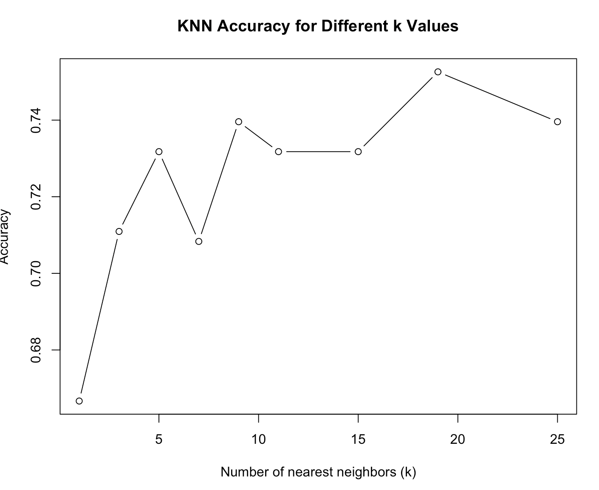
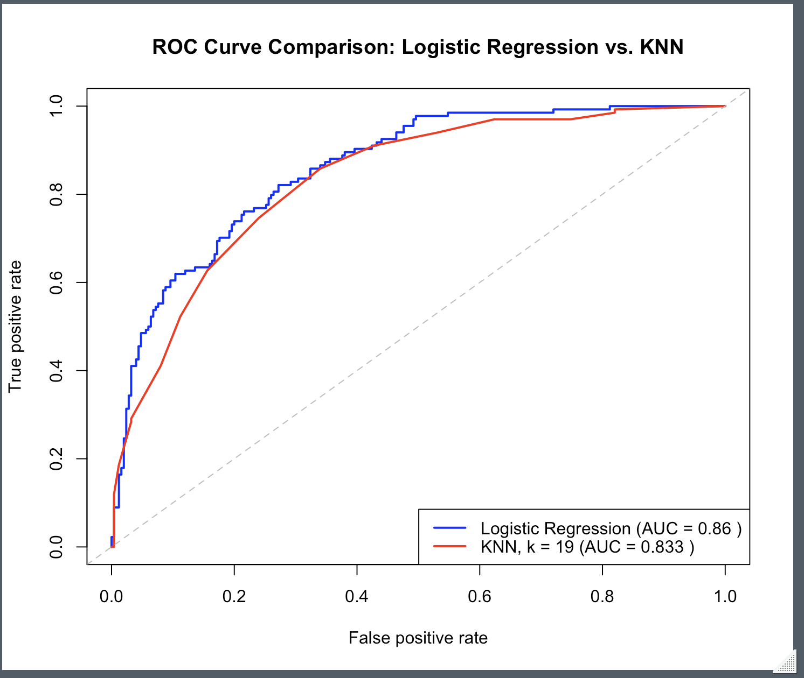
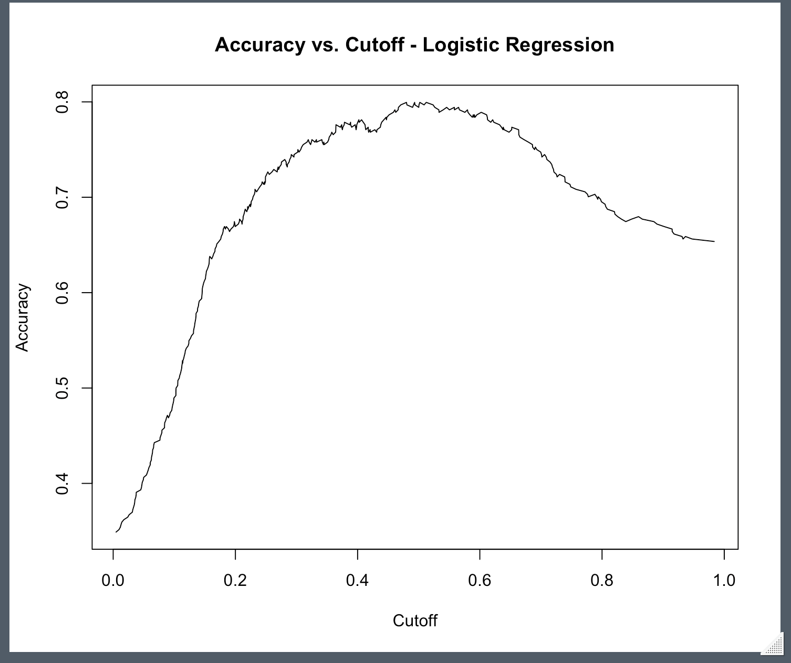
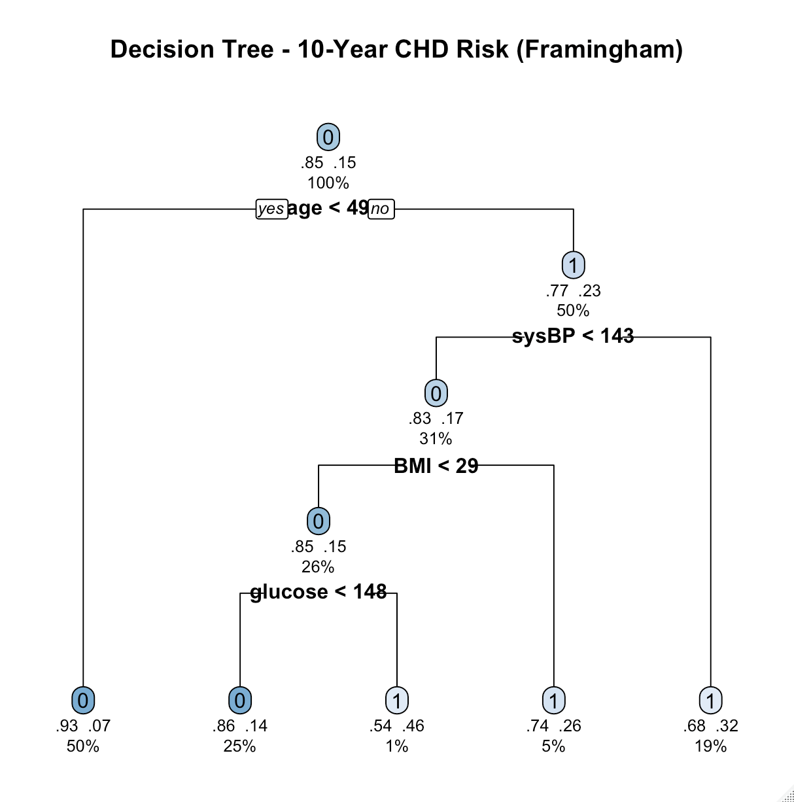

# Predicting Diabetes and Heart Disease Risk with Classification Models in R

**Comparing KNN, logistic regression and decision trees on two public health datasets, with a focus on choosing the right metric for the business problem.**

> Coursework from **CMIS 566 – Introduction to Business Analytics**, M.S. in Computer Management & Information Systems, Southern Illinois University Edwardsville (SIUE). Individual work by Junu Shrestha.

---

## Business Question

In healthcare screening, **missing a high-risk patient costs far more than a false alarm.** Which model best identifies people at risk, and which metrics show that?

## Datasets

| Dataset | Rows | Target | Source |
|---|---|---|---|
| [`diabetes.csv`](data/diabetes.csv) | 768 | `Outcome`: diabetes (1) or not (0) | Pima Indians Diabetes Database (public) |
| [`framingham.csv`](data/framingham.csv) | 4,238 | `TenYearCHD`: heart disease within 10 years | Framingham Heart Study (public Kaggle version) |

## Analysis

### 1. KNN: tuning k ([code](code/01-knn-tuning-diabetes.R))
- 50/50 train/test split. Features were standardized using the training set's mean and SD to avoid data leakage.
- Tested k = 1, 3, 5, 7, 9, 11, 15, 19 and 25 with confusion matrices from `caret`.
- **Best: k = 19, with 75.3% accuracy** (289 of 384 test patients classified correctly).



### 2. Logistic regression vs. KNN ([code](code/02-logistic-vs-knn-diabetes.R))
- Built a logistic regression and converted coefficients to odds ratios for interpretation.
- Evaluated both models at a 0.5 cutoff using ROC curves and AUC (`ROCR`).

| Metric | Logistic Regression | KNN (k = 19) |
|---|---|---|
| Accuracy | **0.794** | 0.742 |
| Recall (sensitivity) | **0.590** | 0.410 |
| Specificity | 0.904 | **0.920** |
| Precision | **0.767** | 0.733 |
| F1 score | **0.667** | 0.526 |
| AUC | **0.860** | 0.833 |

**Conclusion:** Logistic regression is the better model. It catches **59% of diabetic patients vs. 41% for KNN**, which is the metric that matters most in screening. It also shows which factors drive risk (glucose and BMI), which KNN can't.




### 3. Decision tree: 10-year heart disease risk ([code](code/03-decision-tree-heart-disease.R))
- Removed rows with missing values and used a 70/30 train/test split.
- **Class imbalance problem:** only about 15% of patients developed heart disease, so a default tree predicted "no" for everyone.
- **Fix:** a **cost-sensitive loss matrix** that treats a missed heart disease case as **4× worse** than a false alarm.
- The final tree splits on **age, systolic blood pressure, BMI and glucose**. Age is the most important factor.

| Metric | Value |
|---|---|
| Accuracy | 0.726 |
| Recall | 0.451 |
| Specificity | 0.777 |
| Precision | 0.275 |
| F1 score | 0.341 |

The tree trades some accuracy for catching more at-risk patients. A model that predicts "no" for everyone would score about 84% accuracy on this test set but catch none of them.



## Key Takeaways
- **Accuracy alone is misleading** with imbalanced data. Recall, F1 and AUC tell the real story.
- **The right metric depends on the business cost of each error.**
- **Interpretable models** like logistic regression and decision trees are easier to explain to stakeholders than KNN.

## How to Run
Open the project folder in RStudio as the working directory, then run the scripts in `code/`.

```r
install.packages(c("caTools", "class", "caret", "ROCR", "rpart", "rpart.plot"))
```

## Skills Demonstrated

`R` · `Classification` · `KNN` · `Logistic Regression` · `Decision Trees` · `ROC / AUC` · `Confusion Matrix` · `Class Imbalance` · `Model Evaluation`
